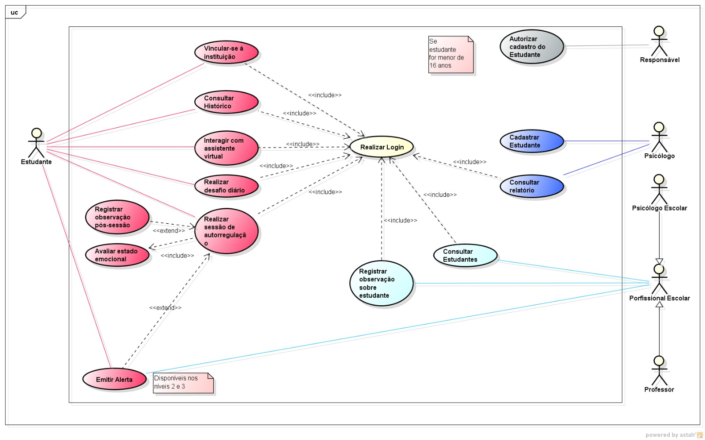

[Português](./README.md) · **English**

# MKpause Use Cases

This section presents the use case model for **MKpause**, describing the actors who interact with the platform and the main features available to each profile.

The use cases were derived from the system's functional requirements and business rules.

---

## Documentation

- [System Actors](./atores.en.md)
- [Use Case Specifications](./casos-de-uso.en.md)
- [Functional Requirements](../02-requisitos/requisitos-funcionais.en.md)
- [Business Rules](../02-requisitos/regras-de-negocio.en.md)

---

## Use Case Diagram

The diagram shows the main interactions between users and MKpause. Labels in the diagram are in Portuguese.



---

## Actors

The main actors represented in the system are:

| Actor | Responsibility |
|---|---|
| Student | Use the self-regulation resources and view their history |
| Teacher | Follow students in the school environment |
| School Psychologist | Follow students within the school context |
| Clinical Psychologist | View the information needed for clinical follow-up |
| Administrator | Manage users, follow-up records, content and links |

The **Guardian** is part of the MKpause domain, but whether they appear in the diagram depends on the features they interact with directly.

Their existence as an entity or link in the system does not require them to be represented as an actor in use cases in which they have no direct interaction.

---

## Main self-regulation flow

One of the main processes represented in the diagram is:

### Complete a Self-Regulation Session

This use case contains the main flow used by the student.

In simplified form:

```text
Student
    │
    ▼
Sign In
    │
    ▼
Complete Self-Regulation Session
    │
    ├── Record pre-session mood
    │
    ├── Evaluate state
    │
    ├── Use a self-regulation activity
    │
    ├── Record post-session mood
    │
    └── Record session information
              │
              └── Raise alert
                   when applicable
```

At the end of the process, the records become part of the student's history.

---

## Alerts

Alerts are raised according to the conditions defined in the business rules.

In the current model, situations classified at **levels 2 and 3** may result in an alert.

Alerts may be made available to the professionals responsible for the student, including:

- Teacher;
- School Psychologist;
- Clinical Psychologist.

Who receives them depends on the links and permissions in the system.

---

## Notes

Teachers and school psychologists may record notes about the students they are authorized to access.

```text
Teacher ─────────────────┐
                         ├──► Record Note
School Psychologist ─────┘
```

The fact that both actors are connected to the same use case **does not mean they must perform the action together**.

Each professional can perform the action on their own, according to their permissions.

---

## Relationships between Use Cases

### `<<include>>`

The `<<include>>` relationship is used when a use case always incorporates the behavior of another use case during its execution.

In MKpause, it represents steps that are required within certain flows.

---

### `<<extend>>`

The `<<extend>>` relationship represents conditional or additional behavior.

It is appropriate when a feature occurs only under a specific condition.

Raising an alert, for example, depends on the situation identified during the self-regulation process.

---

## Association between actor and use case

A line between an actor and a use case means that the actor takes part in, or interacts with, that feature.

It **does not necessarily represent an execution sequence**, nor does it mean that multiple actors associated with the same use case must take part at the same time.

---

## Generalization

Although Teacher and School Psychologist share some features, the current model keeps them as independent actors.

They have their own responsibilities, and sharing certain actions is not, on its own, enough to justify a generalization relationship.

---

## Traceability

The use cases are derived from the requirements defined for MKpause.

The documentation can be followed in this sequence:

```text
Information Sources
        ↓
Requirements
        ↓
Business Rules
        ↓
Use Cases
        ↓
Data Modeling
        ↓
Implementation
        ↓
Testing
```

This structure shows how a need identified while analyzing the problem becomes a feature implemented in the system.

---

## Files

The diagram is available at [`diagramas/diagrama-casos-de-uso.jpeg`](./diagramas/diagrama-casos-de-uso.jpeg).

Whenever the diagram is updated, the version in the repository must also be updated to keep the documentation consistent.
