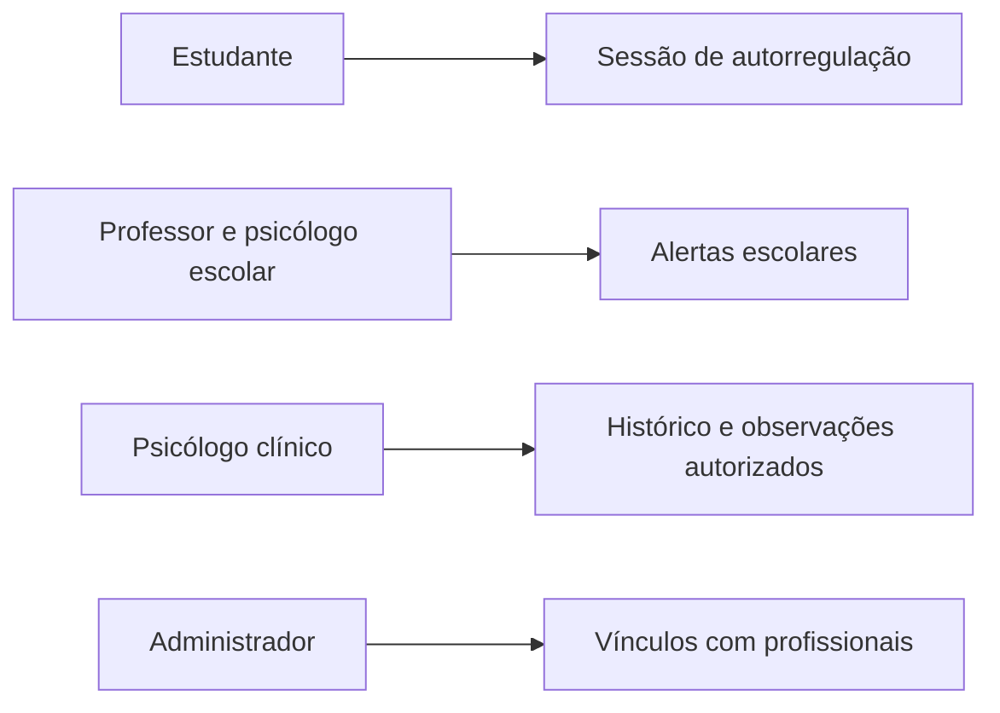

**Português** · [English](./README.en.md)

# Casos de Uso — MKpause

Esta seção apresenta a modelagem de casos de uso do **MKpause**, descrevendo os atores que interagem com a plataforma e as principais funcionalidades disponibilizadas para cada perfil.

Os casos de uso foram definidos a partir dos requisitos funcionais e das regras de negócio do sistema.

---

## Documentação

- [Atores do Sistema](./atores.md)
- [Especificação dos Casos de Uso](./casos-de-uso.md)
- [Requisitos Funcionais](../02-requisitos/requisitos-funcionais.md)
- [Regras de Negócio](../02-requisitos/regras-de-negocio.md)

---

## Diagrama de Casos de Uso

O diagrama apresenta as principais interações entre os usuários e o MKpause.



---

## Atores

Os principais atores representados no sistema são:

| Ator | Responsabilidade |
|---|---|
| Estudante | Utilizar os recursos de autorregulação |
| Professor | Acompanhar estudantes no ambiente escolar |
| Psicólogo Escolar | Realizar acompanhamento dos estudantes no contexto escolar |
| Psicólogo Clínico | Consultar informações necessárias ao acompanhamento clínico |
| Administrador | Gerenciar usuários, fichas, conteúdos e vínculos |


---

## Fluxo principal de autorregulação

Um dos principais processos representados no diagrama é:

### Realizar Sessão de Autorregulação

Esse caso de uso concentra o principal fluxo utilizado pelo estudante.

De forma simplificada:

```text
Estudante
    │
    ▼
Realizar Login
    │
    ▼
Realizar Sessão de Autorregulação
    │
    ├── Registrar humor pré-sessão
    │
    ├── Avaliar estado
    │
    ├── Utilizar atividade de autorregulação
    │
    ├── Registrar humor pós-sessão
    │
    └── Registrar informações da sessão
              │
              └── Emitir alerta
                   quando aplicável
```

Ao final do processo, os registros realizados passam a compor o histórico do estudante.

---

## Alertas

A emissão de alertas ocorre de acordo com as condições definidas pelas regras de negócio.

No modelo atual, situações classificadas nos **níveis 2 e 3** podem resultar na emissão de alerta.

Os alertas podem ser disponibilizados aos profissionais responsáveis pelo estudante, incluindo:

- Professor;
- Psicólogo Escolar;


O recebimento depende dos vínculos e permissões existentes no sistema.

---

## Observações

Professor e Psicólogo Escolar podem registrar observações relacionadas aos estudantes aos quais possuem acesso.

```text
Professor ───────────────┐
                         ├──► Registrar Observação
Psicólogo Escolar ───────┘
```

A presença dos dois atores ligados ao mesmo caso de uso **não significa que ambos precisam executar a ação juntos**.

Cada profissional pode realizar a ação individualmente de acordo com suas permissões.

---

## Relações entre Casos de Uso

### `<<include>>`

A relação `<<include>>` é utilizada quando um caso de uso incorpora obrigatoriamente o comportamento de outro caso durante sua execução.

No MKpause, ela é utilizada para representar etapas necessárias dentro de determinados fluxos.

---

### `<<extend>>`

A relação `<<extend>>` representa comportamentos condicionais ou adicionais.

Esse relacionamento é adequado quando determinada funcionalidade ocorre somente diante de uma condição específica.

A emissão de um alerta, por exemplo, depende da situação identificada durante o processo de autorregulação.

---

## Associação entre ator e caso de uso

Uma linha entre um ator e um caso de uso indica que aquele ator participa ou interage com aquela funcionalidade.

Ela **não representa obrigatoriamente uma sequência de execução** e também não significa que múltiplos atores associados ao mesmo caso de uso precisem participar simultaneamente.

---

## Generalização

Apesar de Professor e Psicólogo Escolar compartilharem algumas funcionalidades, o modelo atual mantém os dois como atores independentes.

Eles possuem responsabilidades próprias e o compartilhamento de determinadas ações não é suficiente, por si só, para justificar uma relação de generalização.

---

## Rastreabilidade

Os casos de uso são derivados dos requisitos definidos para o MKpause.

A documentação pode ser percorrida na seguinte sequência:

```text
Fontes de Informação
        ↓
Requisitos
        ↓
Regras de Negócio
        ↓
Casos de Uso
        ↓
Modelagem de Dados
        ↓
Implementação
        ↓
Testes
```

Essa estrutura permite acompanhar como uma necessidade identificada durante a análise do problema se transforma em uma funcionalidade implementada no sistema.

---

## Diagrama legado

O JPEG em `diagramas/` é um registro histórico. O diagrama acima e as especificações vinculadas descrevem o escopo atual.
